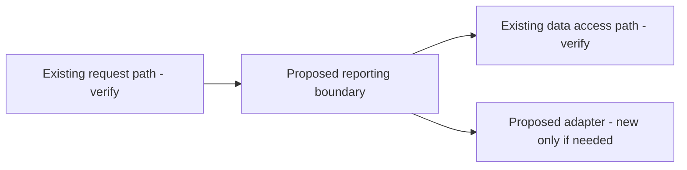

# Planning Examples and Review Rubric

Read this file explicitly when a complex plan needs a concrete shape or before
reviewing a substantial plan. The examples below are illustrative templates, not
claims about any particular repository. They contain no inspected file paths,
line numbers, or executed test results. Replace placeholders only with evidence
from the user's actual project.

## Example: small fix

**Illustrative request:** "Plan a small fix for a filter that resets after a
page reload. Don't edit anything."

**Proportionate response:**

> **Goal:** Preserve the selected filter across reloads without changing the
> existing default behavior.
>
> 1. Confirm the current filter read/write path and how reload behavior is
>    covered by the existing tests. Link only paths verified in the working
>    tree.
> 2. Make the smallest compatible change in the verified existing path.
> 3. Extend the existing relevant test; if no suitable test file exists, list a
>    `Proposed new file` rather than implying one already exists.
>
> **Depends on:** Step 1 establishes where state is lost and which persistence
> mechanism the project already uses.
>
> **Acceptance checks (not run):** the selected filter remains after reload;
> the default still applies when no filter was selected; invalid or absent
> saved values fail safely.
>
> **Risk:** Persistence can expose stale or invalid values; preserve the current
> default and validate restored state.

This is intentionally brief. A full architecture diagram, generic project
phases, and unrelated refactoring are unnecessary for this hypothetical fix.

## Example: saved plan versus inline-only plan

For an already saved plan, verify the actual file and include a clickable
Markdown link in chat, followed by the substantive plan: outcomes, ordered
steps, checks and blockers. Replace any illustrative path with a verified one;
a proposed file path is not a verified link. A goal ID or "plan saved" alone is
not sufficient. Prefer the current repo-local export when verified and label
an older planning copy as such.

For an inline-only request such as "give me three steps, don't save anything",
show those steps in chat without creating a file, goal or fake link. Plan-mode
write restrictions still apply even when a clickable file would be convenient.

Acceptance: inspect a fresh Plan-mode response and open its actual link. The
repository's source-contract checks are not a live model-behavior test and do
not establish that a particular client rendered or opened the link correctly.

## Approval and mode example

Switching to Build changes the mode's execution capability; it does not approve
implementation. Do not end a plan with: "No approval gate beyond switching me to
Build mode."

A clearer closing phrase is: "When you approve implementation and switch to
Build, I can start the agreed changes. Consequential actions still need their
own approval; commit and push approvals remain separate."

Use this as an example, not a promise that execution is otherwise guaranteed.
The user's explicit implementation request and all applicable approval gates
remain necessary.

## Example: architecture plan

**Illustrative request:** "Plan a safe extraction of a reporting capability
from an existing application into a clearer boundary."

Start with a fact-finding phase; do not invent the current architecture. After
inspection, replace the labels below with verified components and link existing
paths relative to the plan document (or show repository-root-relative paths when
a relative link would not resolve). Clearly mark each new path as proposed.

```text
Current file tree (fill only from inspected files):
  <verified existing entry point>
  <verified existing reporting implementation>
  <verified existing test locations>

Proposed additions (only if inspection supports them):
  Proposed new file: <repository-relative path>
```

The following schematic shows a possible workflow, not observed current
behavior. Replace or remove edges to match the inspected design and chosen
option:



An architecture plan can then use phases such as:

| Phase | Work and dependency | Deliverable and acceptance check |
|---|---|---|
| 1. Map current behavior | Inspect verified entry points, data access, callers, tests, and operational constraints. | Evidence-backed current tree and compatibility assumptions; unresolved questions are listed. |
| 2. Choose the boundary | Compare keeping the capability in-process with extracting a separate service/module; document latency, deployment, ownership, failure, and migration tradeoffs. Depends on Phase 1. | Decision record with an explicit recommendation and rejected alternatives. |
| 3. Define contract and migration | Specify inputs, outputs, errors, compatibility, rollout, and rollback before implementation. Depends on Phase 2. | Contract checks cover success, invalid input, and failure behavior; no implementation result is claimed. |
| 4. Implement incrementally | Before edits, capture the git status and relevant diffs as a baseline. Change only verified affected paths; label any new module or tests as proposed until created. Preserve unrelated changes and a reversible migration path. Depends on Phase 3. | Unit/integration acceptance criteria and a rollback check are defined. |
| 5. Validate and release | Run the agreed checks and review operational signals before rollout. Compare new task edits against the baseline rather than attributing every dirty path to this task. Depends on Phase 4. | Actual test and rollout evidence is recorded only after those checks occur; pre-existing dirty paths are kept distinct. |

Adjust the phase count and acceptance criteria to the project. A diagram is
useful only if it makes a real boundary, sequence, or dependency clearer. Mark
unverified infrastructure, ownership, and rollout assumptions explicitly.

## Review rubric

Use `Pass`, `Revise`, or `Not applicable` for each row. For a short plan, apply
only the relevant criteria; do not add sections just to fill a checklist.

| Criterion | Pass when... |
|---|---|
| Outcome and scope | The intended result is explicit; exclusions or constraints are stated when they matter. |
| Evidence and paths | Current-state claims are grounded in inspected evidence; links resolve to existing paths; no invented line numbers or test results appear. |
| Proposed files | Every not-yet-existing path is clearly labelled `Proposed new file` and kept separate from the current tree. |
| Phases and dependencies | Steps are concrete, ordered, and name prerequisites or dependencies; each meaningful phase has a deliverable. |
| Options and tradeoffs | Material alternatives are compared against the user's constraints; a recommendation is justified when requested or useful. |
| Risks and reversibility | Important failure modes, migration/rollback needs, and uncertainty are visible at a level suited to the change. |
| Acceptance tests | Checks describe observable behavior and pass conditions; planned checks are not represented as executed. |
| Trees and diagrams | Any current-state view matches inspected facts; proposed state is visually distinct; unnecessary diagrams are omitted. |
| Approval and mode | Execution is not inferred from a planning request or a switch to Build; implementation needs a clear user request; goal operations need explicit user request; Plan mode is respected; consequential and commit/push gates are clear. |
| Goal progress (when applicable) | The live goal is active; current work follows `currentTask` then `nextTask`; a null `nextTask` triggers full-plan/next-phase inspection; task evidence and phase verification precede completion. See [goal-mode usage](./goal-mode-usage.md). |
| Dirty-work baseline | Existing uncommitted work is preserved; verification compares task edits against the starting status/diffs instead of claiming the entire dirty tree belongs to this task. |
| Clarity and scale | A person can act on the plan, and its detail is proportionate to the task. |
| Plan-mode visibility | The plan itself is shown in chat, not just a goal ID; a verified saved plan has a clickable link, while inline-only requests create no file or fabricated link. |

Revise before presenting if any applicable criterion fails on path accuracy,
fabricated evidence, unclear approval, or mode boundaries. A high overall score
does not waive these blocking issues.
