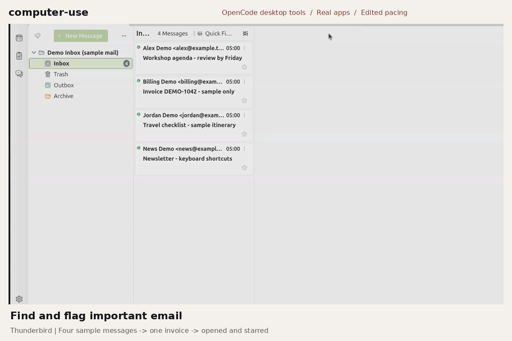

<p align="center">
  
</p>

<h1 align="center">computer-use</h1>

<p align="center">An OpenCode plugin that lets your assistant see and operate desktop apps and a browser.</p>

<p align="center">
  <a href="#installation">Installation</a> ·
  <a href="setup.md">Setup guide</a> ·
  <a href=".opencode/plugins/computer-use/README.md">Plugin reference</a> ·
  <a href="#documentation">Documentation</a>
</p>

[](assets/computer-use-showcase-v2.png)

<p align="center"><sub>Real OpenCode-driven desktop actions. Sample inbox, signed-out browsing, pauses shortened.<br>
<a href="assets/computer-use-showcase-v2.png">Still image</a> · <a href="docs/demo/README.md">Email, YouTube &amp; shopping clips</a></sub></p>

---

### Installation

**Let your assistant handle setup.** Copy this prompt into a coding assistant
with repository and terminal access; it is not a shell command:

```text
Read https://github.com/jtmb/computer-use/blob/main/setup.md alongside AGENTS.md: inspect paths, preview before applying, respect the current interactive/Build-auto policy and existing authority, leave the optional GNOME bridge off unless selected, let me handle sign-ins, then verify.
```

**Prefer the terminal?** You need OpenCode v2, Node.js 22.18+ and Python 3. Open
OpenCode in this checkout and the plugin loads automatically. Install the browser
backend's pinned dependency once:

```sh
npm --prefix tools/computer-use-browser ci --omit=dev --ignore-scripts
```

To use the tools in other projects, register `.opencode/plugins/computer-use` in
their OpenCode config. [setup.md](setup.md) has the exact entry, the optional
GNOME window-control bridge (preview first; it never enables itself) and rollback.

### What it does

| Tools | What they do |
| --- | --- |
| `desktop` | List GNOME apps, read their accessible elements, preview then apply clicks, focus and text, capture screens and manage windows. |
| `web` | Open a session-isolated browser, take snapshots and screenshots, act on page elements, and hand sign-ins to you. |
| `cua` | A persistent JavaScript cell that scripts `desktop` and `web` together, with the same permissions. |

Ask for outcomes in ordinary language, for example:

- "Find the invoice email and star it for follow-up."
- "Find YouTube tutorials about Blender."
- "Compare USB-C hubs on Amazon. Don't buy anything."

Desktop tools need a native GNOME session with accessibility enabled; WSL has no
GNOME desktop to drive.

### Checks

| Task | Command |
| --- | --- |
| Plugin, browser, runtime and bridge test suites | `node scripts/run-plugin-suites.mjs` |
| Offline checks that CI runs | `node scripts/ci-offline.mjs --no-git` |
| Live service and active-plugin check | `./scripts/health-check.sh` |

Source tests use fixtures and never touch your desktop or browser. The health
check doesn't prove every desktop or browser workflow works on your machine.

### Documentation

- [Setup guide](setup.md): prerequisites, registration, the GNOME bridge and verification.
- [Plugin reference](.opencode/plugins/computer-use/README.md): every tool, limit and safety rule.
- [Feature inventory](docs/features.md): what is present, prerequisites and what remains unverified.
- [Browser backend](tools/computer-use-browser/README.md) · [Shared runtime](tools/computer-use-runtime/README.md) · [GNOME bridge](tools/gnome-window-control/README.md).
- [README layout guide](docs/readme-layout.md) · [Maintainer guide](AGENTS.md).

The skills still live here for now: [Browse all 34 skills →](.opencode/skills/README.md).
Other plugins and MCPs that used to be in this repository moved out on 2026-11-19;
[setup.md](setup.md#moved-out-of-this-repository-2026-11-19) lists where they went.

### You stay in control

Actions follow **observe → preview → act → verify**. Desktop and page mutations
need a fresh preview token. Password fields are refused, sign-ins stay with you,
and tool approvals remain enabled. Nothing here authorizes publishing, commits,
pushes or destructive actions, and no credentials are stored.

**Build auto means no routine questions, including Git.** Authorized goals keep
moving; blocked actions are reported without a prompt. [Autonomy details](docs/autonomous-work.md).
