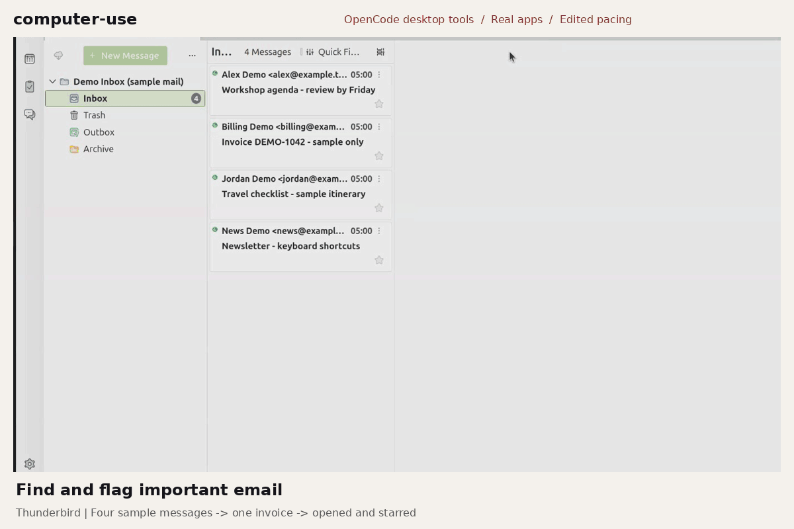

<p align="center">
  
</p>

<h1 align="center">computer-use</h1>

<p align="center">Skills and tools that let OpenCode work with your computer.</p>

<p align="center">
  <a href="#installation">Installation</a> ·
  <a href="setup.md">Setup guide</a> ·
  <a href=".opencode/skills/README.md">Explore the skills</a> ·
  <a href="#documentation">Documentation</a>
</p>

[](assets/computer-use-showcase-v2.png)

<p align="center"><sub>Real OpenCode-driven desktop actions. Sample inbox, signed-out browsing, pauses shortened.<br>
<a href="assets/computer-use-showcase-v2.png">Still image</a> · <a href="docs/demo/README.md">Email, YouTube &amp; shopping clips</a></sub></p>

---

### Installation

**Let your assistant handle setup.** Copy this prompt into a coding assistant
with repository and terminal access; it is not a shell command:

```text
Read https://github.com/jtmb/computer-use/blob/main/setup.md and the checkout's onboarding.md alongside AGENTS.md: inspect paths, dry-run first, respect the current interactive/Build-auto policy and existing authority, leave optional integrations off unless selected, let me handle credentials, then verify.
```

**Prefer the terminal?** You need OpenCode v2, Bash, Python 3, and this checkout. Node.js is
needed for plugin checks; GitHub tools use your existing `gh` login.
See [setup.md](setup.md) for exact versions, optional dependencies, and rollback.
For the complete assistant-led workflow and interactive/Build-auto defaults, see
[onboarding.md](onboarding.md).

> **Review before applying:** this is a personal configuration, not a universal
> installer. Adapt the paths and models in [`global/`](global/). Full deployment
> replaces configured agents and commands after backing them up.

Preview first from the repository root:

```sh
./scripts/onboard.sh
```

After reviewing the planned changes:

```sh
./scripts/onboard.sh --apply
```

Add `--with-browser` to install the optional Playwright MCP dependency. Setup
also supports explicit `--with-chatgpt` opt-in; [prerequisites and limits](setup.md#optional-chatgpt-connector) apply.
It doesn't install OpenCode or sign you into accounts. After applying, reload the
TUI with **Ctrl+P → `service.restart`**.

### Skills

- **Email and desktop apps** — find messages, flag follow-ups, and operate real windows.
- **Browser** — discover YouTube videos, research Amazon products, and navigate sites.
- **GitHub** — inspect repositories, issues, pull requests, and failing checks.
- **Continuity** — carry decisions, task memory, and handoffs between sessions.
- **Create and maintain** — work with apps, Blender, game tests, and README GIFs.

[Browse all 34 skills →](.opencode/skills/README.md) Each guide lists its prerequisites;
setup does not install every skill's dependencies. Native desktop tools need
GNOME accessibility and screenshot support; WSL has separate limits.

### Usage

Ask for outcomes in ordinary language, for example:

- "Find the invoice email and star it for follow-up."
- "Find YouTube tutorials about Blender."
- "Compare USB-C hubs on Amazon. Don't buy anything."

| Task | Command |
| --- | --- |
| Preview onboarding without writes or a live search | `./scripts/onboard.sh` |
| List available models | `./scripts/setup-model.sh --list` |
| Choose a model interactively, then apply | `./scripts/setup-model.sh --apply` |
| Check the repository and running setup | `./scripts/health-check.sh` |

The health check verifies the local setup, connected MCPs, plugins, and source
tests. It doesn't prove every desktop or browser workflow works.

### Documentation

- [Feature inventory](docs/features.md) — what is present, prerequisites, and what remains unfinished.
- [Setup guide](setup.md) — models, search, configuration, rollback, troubleshooting.
- [LLM onboarding](onboarding.md) — setup conversation, choices, progress and verification.
- [Skill catalog](.opencode/skills/README.md) — workflows, examples, and requirements.
- [README layout guide](docs/readme-layout.md) — repository-specific maintainer rules.
- [Configuration](global/) · [Project wiring](opencode.json) · [Maintainer guide](AGENTS.md).

Skills load directly from this checkout's `.opencode/skills/` directory.

### You stay in control

Actions follow **observe → preview → act → verify** where supported. Tool approvals
remain enabled; passwords and sign-ins stay with you. Setup doesn't authorize
publishing, commits, pushes, or destructive actions. Credentials aren't stored here.

**Build auto means no routine questions, including Git.** Authorized goals keep
moving; blocked actions are reported without a prompt. [Autonomy details](docs/autonomous-work.md).
