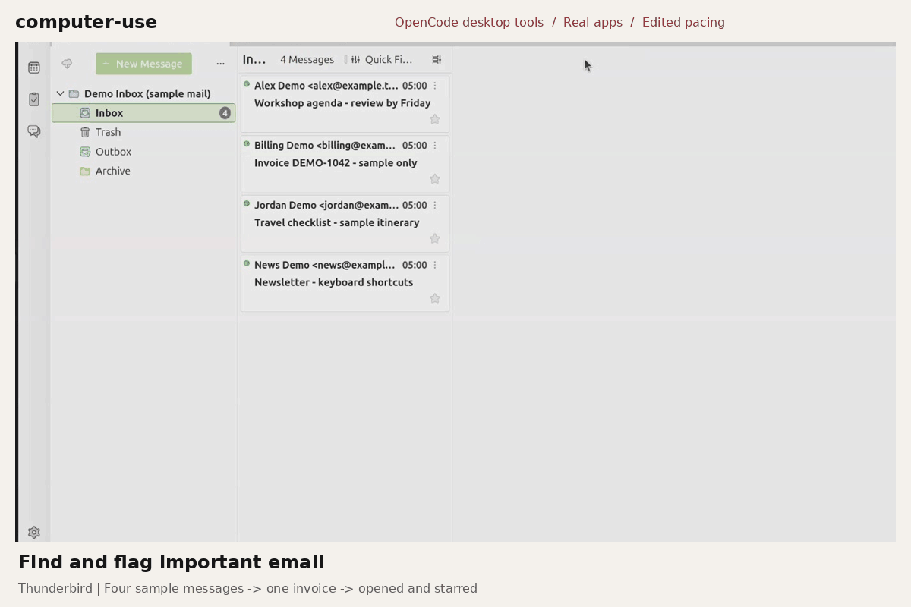
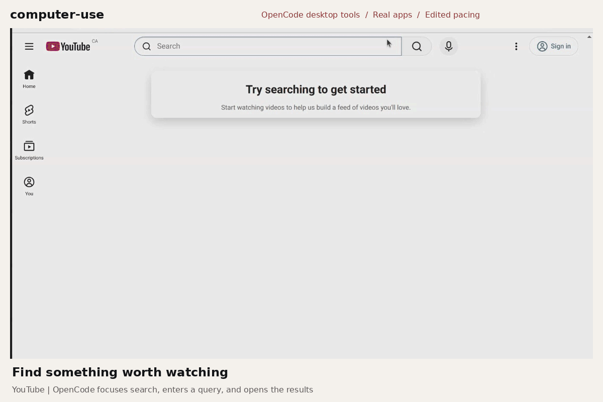
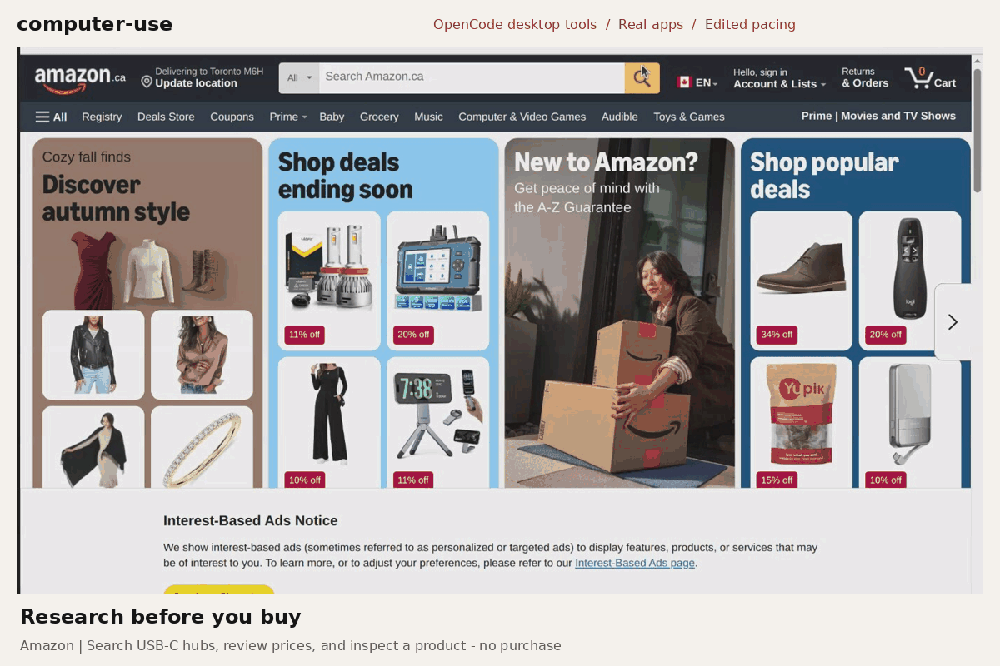

# Computer-use demos

> **Drafts, not the accepted replacement.** The clips below are preserved app-only
> prototypes. The requested main demo must show a real clean OpenCode window beside
> the controlled application in simultaneous footage, with deliberate zooms and
> transitions. No satisfactory simultaneous recording or approved motion preview
> exists yet. See [window-control verification and remaining gates](window-control-verification.md).

The new [simultaneous capture and motion workflow](simultaneous-workflow.md)
provides bounded recording, live-frame checks, dense real-PTS export and eased
editing. Its idle/synthetic tooling preflights are not action-demo acceptance.

Real applications, controlled by OpenCode's desktop tools. These are edited native
screen recordings, not terminal replays, fabricated app interfaces, or simulated
assistant conversations. Tool calls ran in the authoring OpenCode session; the
footage shows their application results, not an invented OpenCode chat overlay.

## Manage email



Thunderbird uses a separate local-only profile with four clearly labeled messages
from `example.test`. OpenCode selects Inbox, opens Quick Filter, enters `invoice`,
opens the one result, and presses the real Starred toggle. The orange star and
filtered message count were verified visually. No personal inbox was opened and
no email was sent or deleted.

## Find a video



In a separate signed-out Chrome profile, OpenCode focuses YouTube's real search
field, types `OpenCode AI coding agent`, and presses its named Search button.
The resulting video list was verified. The full recording also opens a result;
the edited clip stops at search results rather than showcasing pre-roll adverts.

## Research a purchase



OpenCode launches Amazon.ca, searches for `USB C hub HDMI`, inspects listed prices,
and opens a docking station's product link to read its ports, rating, and price.
The browser remains signed out; no cart, purchase, sign-in, consent, or payment
control was activated. Prices and listings are recording-time examples, not
recommendations or current-price promises.

## Capture and editing

- Native GNOME `org.gnome.Shell.Screencast.ScreencastArea` recorded a verified
  public demo region. Its client connection remained alive until finalization;
  a one-shot `gdbus call` loses its sender and is not a complete recorder.
- Interactions used `desktop_find` and preview/apply `desktop_act` tokens. Where
  web inputs did not expose editable-text writes, named focus and verified native
  keyboard input were used. After each mutation, desktop screenshots verified
  results; those verification images were deleted, not reused as public assets.
- GStreamer decoded the separate video recordings to 1440x924 frames at 2 fps.
  Pauses and verification-notification intervals were cut, browser/dock edges
  cropped, and explanatory captions added outside the real application pixels.
  No app state, cursor motion, tool call, message, or result was fabricated.
- `encode-showcase.py` contains the explicit source-frame selections. The evidence
  file, `assets/showcase-evidence-v2.json`, records selected-frame hashes, source
  timestamps, editing/privacy disclosures, and decoded GIF metadata.
- The temporary-filesystem quota was reached during PNG extraction. Complete
  JPEG frame sets were retained in the approved Downloads area instead. A server
  restart then made the original `/tmp/opencode` MP4s unavailable; the GIFs are
  encoded from the already-decoded native video frames, without repeating actions.
  The source frames and isolated sample-mail profile are transient, not Git assets.

The source-frame selection is tied to this recording, not a universal automation
script. A new capture needs a supported route, verified app/region, fresh profiles,
and unused output names. Never change permissions, bypass a capture denial,
disable sandboxing, or record authentication to reproduce a demo.

The encoder needs existing Python Pillow and DejaVu fonts. A representative
re-encoding command, using retained frames and an **empty output directory**, is:

```sh
python3 docs/demo/encode-showcase.py --frames-root /path/to/verified-frames --output-dir /path/to/empty-output
```

It writes new GIFs, a PNG poster, and evidence; it refuses existing names. It does
not capture, install, delete, or publish. Use approved local save paths.

## Verification

```sh
PYTHONDONTWRITEBYTECODE=1 python3 -m unittest discover -s docs/demo -p 'test_showcase.py' -v
git diff --check
wc -l README.md
```

Check decoded scenes, timing, loop behavior, privacy, and README-size readability.
The root README must stay below 170 physical lines. A still alternative is linked
from the README. Publication, commits, and pushes require separate approval.

The earlier `record.py`/`test_record.py` and `readme-demo-v1` assets are retained
as the superseded CLI prototype, not used as the main computer-use showcase.
